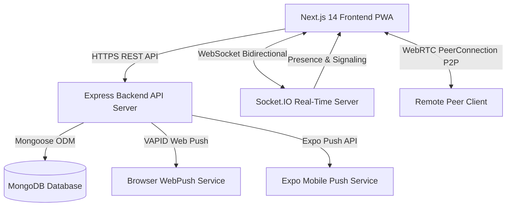
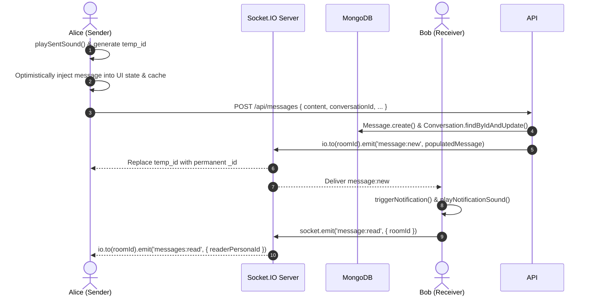
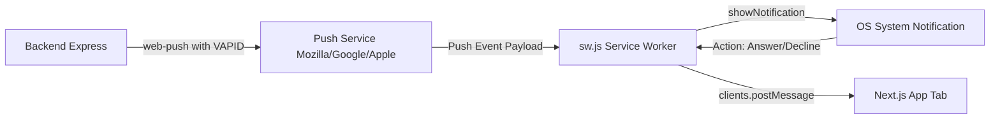

# GenAce Architecture & Implementation Master Guide: From WebRTC Calls to Real-Time Chat Engine

This document provides a comprehensive, code-level breakdown of the **GenAce (Donchat)** real-time communications platform. It details every core subsystem, data model, network flow, and frontend/backend integration—from WebRTC signaling to multi-persona identity, privacy vectors, and background push notifications.

---

## 1. Executive System Topology



GenAce is built upon a distributed client-server architecture:
- **Frontend**: Next.js 14 (App Router), React 18, Tailwind CSS, Lucide icons, HTML5 Web Audio & MediaDevices APIs.
- **Backend**: Node.js & Express with modular REST controllers and middleware.
- **Real-Time Duplex**: Socket.IO server mounted directly on the HTTP server, managing presence, typing, messaging fanout, and WebRTC signaling.
- **Persistence**: MongoDB via Mongoose with compound indexing for low-latency queries.
- **Media & Push**: Cloudinary / local multipart disk storage, Web Push (VAPID / Web-Push library), and Expo Push services.

---

## 2. Multi-Persona Identity & Authentication System

Unlike traditional chat apps where an account maps 1:1 with a profile, GenAce decouples the **Master Account** from **Active Personas**.

### 2.1 Schema Architecture

1. **User Schema (`backend/models/User.js`)**:
   - `email`: Master login email.
   - `password`: Bcrypt hashed password.
   - `masterName`: Legal or primary account name.
   - `personas`: Array of `ObjectId` references to `Persona` documents.
   - `chatPasscode`: Hashed passcode for locked/hidden conversations.
   - `chatLockEnabled`: Boolean flag toggling privacy mode.
   - `lockedConversations` & `lockedSpaces`: Array of string IDs hidden behind the passcode.

2. **Persona Schema (`backend/models/Persona.js`)**:
   - `userId`: Back-reference to the parent User document.
   - `username`: Unique handle across the entire platform (`@username`).
   - `displayName`: Formatted display name (e.g., "Agent Smith").
   - `avatar`: URL to profile image or Cloudinary asset.
   - `bio`: Persona biography or status note.
   - `type`: Enum (`personal`, `business`, `gaming`, `anonymous`).
   - `status`: Enum (`online`, `away`, `dnd`, `offline`).
   - `customStatus`: Free-form status string (e.g., "Designing Fluid Spaces...").
   - `blockedPersonas`: List of persona IDs mutually blocked.
   - `contacts`: Personal address book of connected personas.
   - `pushTokens`: Web Push & Expo push subscriptions.

### 2.2 JWT Authentication & Context Switching

When a user logs in via `POST /api/auth/login`:
```javascript
// Token generation encodes both userId and active personaId
const token = jwt.sign(
  { userId: user._id, personaId: activePersona._id },
  process.env.JWT_SECRET,
  { expiresIn: '30d' }
);
```

On persona switch (`POST /api/personas/switch`):
A new JWT is generated with the selected `personaId`. The frontend updates its global `AuthContext` and reconnects the Socket.IO client:
```javascript
socket.emit('presence:announce', { personaId: newPersona._id });
```
This guarantees instant isolation: conversations, presence status, blocked contacts, and typing indicators immediately reflect the selected persona without requiring a full re-login.

---

## 3. Real-Time Voice & Video Calling Engine

The calling engine uses **WebRTC (Web Real-Time Communication)** for peer-to-peer audio and video transmission, paired with **Socket.IO** as the stateful signaling server.

```mermaid
sequenceDiagram
    autonumber
    actor Caller as Caller Client
    participant Server as Socket.IO & Push Server
    actor Callee as Callee Client

    Caller->>Caller: getUserMedia({ audio: true, video: isVideo })
    Caller->>Server: socket.emit('call:initiate', { targetPersonaId, roomId, isVideo, callId })
    Server->>Server: Register in activeRingingCalls Map (45s timeout)
    Server-->>Callee: socket.emit('call:incoming', callData)
    Server-)Callee: sendPushNotifications (Web Push + Sound)
    Caller->>Caller: playRingback()
    Callee->>Callee: playIncomingRingtone() + navigator.vibrate()

    alt Callee Accepts
        Callee->>Callee: stopAllSFX() & getUserMedia(...)
        Callee->>Server: socket.emit('call:accept', { targetPersonaId, callId })
        Server-->>Caller: socket.emit('call:accepted', { callId, responderSocketId })
        Caller->>Caller: pc.createOffer() -> pc.setLocalDescription(offer)
        Caller->>Server: socket.emit('call:signal', { signal: offer })
        Server-->>Callee: socket.emit('call:signal', { signal: offer })
        Callee->>Callee: pc.setRemoteDescription(offer) -> pc.createAnswer()
        Callee->>Server: socket.emit('call:signal', { signal: answer })
        Server-->>Caller: socket.emit('call:signal', { signal: answer })
        Caller->>Caller: pc.setRemoteDescription(answer)
        Caller<-->>Callee: P2P Audio / Video Stream via RTCPeerConnection
    else Callee Declines / Timeout
        Callee->>Server: socket.emit('call:reject', { callId, reason })
        Server-->>Caller: socket.emit('call:rejected', { callId })
        Caller->>Caller: cleanupCall() & playCallEnded()
    end
```

### 3.1 Signaling Architecture (`backend/config/socket.js`)

1. **Active Ringing Calls Registry**:
   The server maintains an in-memory `activeRingingCalls` Map:
   ```javascript
   export const activeRingingCalls = new Map();
   // Key: callId -> { callId, callerPersona, callerSocketId, targetPersonaId, roomId, isVideo, timestamp, timeoutTimer }
   ```
   - Automatically expires after **45 seconds** if unanswered, emitting `call:ended { reason: 'timeout' }` to both parties.
   - Cleans up automatically if the caller disconnects mid-ring.

2. **Targeted Socket Routing (`callTarget`)**:
   ```javascript
   const callTarget = (targetPersonaId, targetSocketId) =>
     targetSocketId && io.sockets.sockets.get(targetSocketId)
       ? io.to(targetSocketId)
       : io.to(`persona:${targetPersonaId}`);
   ```
   If a user is logged in across 2 browser tabs or devices, answering on device A cancels ringing on device B via `call:answered-elsewhere`, preventing audio glare or double-answering conflicts.

3. **Background Fallback Query (`call:query-pending`)**:
   If a user was on a locked phone screen or reloaded their browser when a call was placed, the client queries pending calls upon reconnecting, and the server immediately re-emits `call:incoming`.

### 3.2 Peer Connection & SDP Negotiation (`frontend/src/app/chat/page.js`)

1. **ICE Servers & STUN/TURN**:
   The client loads STUN/TURN configurations dynamically from `/api/ice-servers`:
   ```javascript
   const pc = new RTCPeerConnection({
     iceServers: iceServersRef.current || [{ urls: 'stun:stun.l.google.com:19302' }],
     iceCandidatePoolSize: 4
   });
   ```

2. **Track Attachment & Transceiver Synchronization**:
   ```javascript
   localStream.getTracks().forEach(track => {
     pc.addTrack(track, localStream);
   });
   pc.getTransceivers().forEach(t => { t.direction = 'sendrecv'; });
   ```

3. **Trickle ICE Candidate Queuing**:
   Candidate objects arriving before the remote SDP description is set are placed into `pendingCandidatesRef.current` and flushed via `processPendingCandidates(pc)` once `setRemoteDescription` resolves, avoiding negotiation race conditions.

4. **Call Hardware Controls**:
   - **Mute / Unmute**: Flips `track.enabled` on local audio tracks directly without tearing down the connection.
   - **Camera Toggle**: Flips `track.enabled` on local video tracks.
   - **Screen Sharing**: Calls `navigator.mediaDevices.getDisplayMedia()` and replaces the video track on the WebRTC RTCRtpSender via `sender.replaceTrack(screenTrack)`. When screen sharing ends, it seamlessly swaps back to the camera track.

### 3.3 Audio & Ringtone Subsystem

GenAce implements a dual audio engine:
1. **Dynamic Web Audio Synthesis (`lib/callSFX.js`)**:
   Uses the Web Audio API (`AudioContext`, `OscillatorNode`, `GainNode`) to generate authentic telecom frequencies:
   - **Ringback Tone**: Dual-tone multi-frequency (440Hz + 480Hz) pulsed in 2s-on / 4s-off cadence.
   - **Call Connected Chime**: Rising melodic arpeggio (C5 $\rightarrow$ E5 $\rightarrow$ G5).
   - **Call Ended Tone**: Descending tone (440Hz $\rightarrow$ 220Hz).
2. **Device-Native / Custom Ringtone Manager (`lib/ringtoneManager.js`)**:
   - Supports uploading custom audio files (`.mp3`, `.wav`, `.ogg`), stored locally in **IndexedDB**.
   - Triggers native hardware vibration via `navigator.vibrate([1000, 500, 1000, 500, 1000])`.
   - Bypasses browser autoplay restrictions using silent audio unlock events on first user interaction.

---

## 4. Real-Time Chat Engine

### 4.1 Schema & Data Models

1. **Conversation Model (`backend/models/Conversation.js`)**:
   - `type`: `direct` (1-on-1) or `group`.
   - `participants`: Array of Persona references.
   - `privacyMode`: `normal`, `private`, `disappearing`, `burn`, `vault`, `anonymous`.
   - `spaceId`: If linked to a fluid space, references the parent `Space`.
   - `lastMessage`: Pointer to the most recent Message for instant inbox rendering.
   - `deletedBy`: Array of Persona IDs who hid the conversation locally.

2. **Message Model (`backend/models/Message.js`)**:
   - `conversationId` / `spaceId`: Target context.
   - `senderPersonaId`: Author persona reference.
   - `content`: Text payload.
   - `contentType`: `text`, `voice`, `image`, `video`, `file`, `document`, `poll`, `task_card`, `secret_lovers_invite`.
   - `mediaUrl`: URL to uploaded attachment.
   - `voiceDuration`: Duration in seconds for voice notes.
   - `privacyMode`: Conversation privacy setting snapshot.
   - `isBurned`: True if viewed in "burn-on-read" mode.
   - `reactions`: Array of `{ emoji, personaId }`.
   - `replyTo`: Parent message reference for threaded replies.
   - `status`: `sent`, `delivered`, `read`.
   - `expiresAt`: TTL timestamp for disappearing messages (auto-removed by MongoDB).

### 4.2 0ms Optimistic Messaging & Delivery Loop



1. **Optimistic UI Update**:
   When the user presses Enter or taps Send:
   - A unique temporary ID (`temp_1729...`) is created.
   - The message is immediately rendered with a subtle `pending: true` indicator.
   - An audio chime (`playSentSound()`) provides instant haptic-like feedback.
2. **Server Ingestion & Fanout**:
   - `sendMessage` controller validates room permissions and blocklists.
   - Populates sender persona metadata (`displayName`, `avatar`, `status`).
   - Simultaneously writes to MongoDB and fans out via Socket.IO:
     - `io.to(targetRoom).emit('message:new', msg)`
     - `io.to('persona:' + recipientId).emit('message:new', msg)` (for instant inbox snippet refresh across all tabs).
3. **Delivery & Read Acknowledgments**:
   - When the receiver views the chat viewport, `markActiveRoomAsRead()` triggers `socket.emit('message:read')`.
   - The server updates `status: 'read'` in MongoDB and broadcasts `messages:read`, turning the sender's checkmarks from delivered to read.

### 4.3 Privacy Vectors Breakdown

| Privacy Mode | Description | Technical Implementation |
|---|---|---|
| **Normal** | Standard persistent messaging | Regular MongoDB document with real-time sync |
| **Private** | Confidential view | Strips message snippets from notifications and mobile lock screens |
| **Disappearing** | Ephemeral messaging | Sets `expiresAt = Date.now() + 24h`; MongoDB TTL index automatically purges expired records |
| **Burn-on-Read** | View once and destroy | Payload rendered masked; client calls `POST /api/messages/:id/burn` on click, destroying content on the server immediately |
| **Vault** | High-security space | Content gated behind the user's master chat passcode |
| **Anonymous** | Ghost identity | Masks sender handle and details with randomized ghost identity in the space |

---

## 5. Media Upload Pipeline & Voice Notes

### 5.1 Multi-Tier File Upload Pipeline (`backend/routes/upload.routes.js`)
File uploads pass through an intelligent fallback pipeline:
1. **Cloudinary CDN**: If configured in `.env`, streams images/videos/audio to Cloudinary CDN for global caching and resizing.
2. **Local Disk Storage**: If Cloudinary is absent or errors, saves files to `backend/uploads/` with unique sanitized filenames.
3. **Base64 Direct Serialization**: Fallback mode for high-availability environments where file storage writes are restricted.

### 5.2 Voice Notes Engine (`frontend/src/components/MessageInput.jsx`)
- Uses the browser's `MediaRecorder` API with mimeType `audio/webm;codecs=opus` (or `audio/mp4` on iOS Safari).
- Visualizes real-time decibel input levels using HTML5 `AudioContext` and `AnalyserNode`.
- Uploads the recorded audio blob directly to `/api/upload`, extracts duration, and dispatches a message with `contentType: 'voice'` and `voiceDuration`.

---

## 6. Fluid Spaces, Collaboration & Games

### 6.1 Fluid Spaces Architecture (`backend/models/Space.js`)
Spaces represent dynamic group environments combining chat, shared tasks, live polls, and games:
- **Roles**: `owner`, `admin`, `member`.
- **Visibility**: `public` (discoverable in Explore) or `private` (invite only).
- **Embedded Conversation**: Each space has a dedicated `conversationId` for unified chat storage.

### 6.2 Secret Lovers Game Engine (`backend/models/SecretLoversGame.js`)
An interactive social card game integrated directly into spaces:
- Turn-based matchmaking and secret card selections.
- Emits dedicated interactive chat cards (`secret_lovers_invite`, `secret_lovers_summary`).
- Real-time turn progression managed via Socket.IO events (`secretLovers:stateUpdate`).

---

## 7. AI Assistant & Space Summarization Engine

The backend provides context-aware AI operations (`backend/services/ai.service.js`):

```javascript
export const processAIQuery = async ({ action, conversationId, spaceId, queryText }) => {
  // Scoped strictly to the active space's recent 30 messages
  const messages = await Message.find(filter).sort({ createdAt: -1 }).limit(30);
  ...
}
```

- **`SUMMARIZE` / `CATCH_UP`**: Aggregates conversation participants, extracts conversational focus, and produces a bulleted briefing.
- **`EXTRACT_DECISIONS`**: Scans messages for decision keywords (`agree`, `decided`, `approved`, `let's`) and tabulates conclusions with authors and timestamps.
- **`EXTRACT_TASKS`**: Identifies action items (`todo`, `need to`, `build`, `fix`) and proposes assignees.
- **`CUSTOM_QUERY`**: Natural-language semantic search across the conversation history.

---

## 8. Web Push Notifications & Service Worker



1. **VAPID Key Auto-Generation (`backend/config/push.js`)**:
   - Generates and persists VAPID keypairs in `config/vapid.json` if environment variables are not supplied.
2. **Background Calls & Action Buttons (`public/sw.js`)**:
   - When a call arrives while the browser is minimized or closed:
     - The service worker displays a persistent notification with `requireInteraction: true` and action buttons: `📞 Answer` and `✕ Decline`.
     - Clicking **Decline** directly invokes `POST /api/calls/reject` from inside the service worker thread, alerting the caller without requiring the full app to load.
     - Clicking **Answer** calls `clients.openWindow('/chat')` and brings the call modal into focus.

---

## 9. Progressive Web App (PWA) Subsystem

The PWA enables zero-friction, native-like installation directly from any shared link.

1. **Manifest Configuration (`public/manifest.json`)**:
   - Configured with `display: "standalone"`, `start_url: "/"`, `display_override: ["standalone", "minimal-ui", "window-controls-overlay"]`.
   - Incorporates dedicated 192x192 and 512x512 standard PNG and maskable PNG icons.
2. **Service Worker Caching (`public/sw.js`)**:
   - Implements a network-first fetch handler for static assets and HTML shell fallback, fulfilling Chromium's PWA installability requirements while exempting `/api` and `/socket.io`.
3. **Install Lifecycle Manager (`frontend/src/context/PWAContext.jsx`)**:
   - Detects standalone mode via `matchMedia('(display-mode: standalone)')`.
   - Captures and holds the browser's `beforeinstallprompt` event.
   - Provides unified state (`canInstall`, `isInstalled`, `isIOS`, `promptInstall`) to the application.
4. **Interactive Modal (`frontend/src/components/InstallPromptModal.jsx`)**:
   - Displays a glassmorphic prompt with glowing app icon and feature highlights.
   - On Android/Desktop: triggers `deferredPrompt.prompt()`.
   - On iOS Safari: renders a step-by-step visual guide pointing to Safari's Share button (⎋) $\rightarrow$ *"Add to Home Screen"* (➕).
   - Keeps a floating quick-install badge if dismissed, ensuring one-tap installation anytime.

---

## 10. File & Directory Reference

```text
DONCHAT/
├── backend/
│   ├── config/
│   │   ├── db.js                 # MongoDB connection initialization
│   │   ├── push.js               # Web Push (VAPID) & Expo Push service
│   │   └── socket.js             # Real-time Socket.IO server & WebRTC signaling
│   ├── controllers/
│   │   ├── auth.controller.js    # Registration, login, password reset
│   │   ├── message.controller.js # Message creation, read receipts, reactions, burn
│   │   ├── persona.controller.js # Multi-persona creation, editing, switching
│   │   └── space.controller.js   # Spaces, members, tasks, and polls
│   ├── models/
│   │   ├── Conversation.js       # 1-on-1 and group conversation schema
│   │   ├── Message.js            # Unified message schema with privacy vectors
│   │   ├── Persona.js            # Identity persona schema
│   │   ├── PushSubscription.js   # Browser push subscription storage
│   │   ├── Space.js              # Fluid spaces schema
│   │   └── User.js               # Master user account schema
│   └── server.js                 # Express HTTP server setup & middleware
└── frontend/
    ├── public/
    │   ├── manifest.json         # PWA metadata & application manifest
    │   ├── sw.js                 # Service worker for push & offline shell
    │   ├── icon-192.png          # High-res PWA icon (192x192)
    │   └── icon-512.png          # High-res PWA icon (512x512)
    └── src/
        ├── app/
        │   ├── chat/page.js      # Core messaging & WebRTC call controller
        │   ├── layout.js         # Root layout with PWA, Socket, and Auth providers
        │   └── welcome/page.jsx  # Welcome landing page with install triggers
        ├── components/
        │   ├── CallModal.jsx          # Active WebRTC audio/video call UI
        │   ├── IncomingCallModal.jsx  # Ringing incoming call modal with silence controls
        │   ├── InstallPromptModal.jsx # Cosmic PWA install modal & floating pill
        │   ├── MessageInput.jsx       # Voice note recorder, attachments, text input
        │   ├── MessageItem.jsx        # Rich message bubble, reactions, burn animations
        │   ├── SettingsView.jsx       # Custom ringtones, passcode lock, profile settings
        │   └── Sidebar.jsx            # Conversations, spaces list, persona switcher
        ├── context/
        │   ├── AuthContext.jsx   # Master user & active persona state
        │   ├── PWAContext.jsx    # PWA install prompt & standalone detection
        │   └── SocketContext.jsx # Socket.IO client singleton connection
        └── lib/
            ├── api.js                # Axios HTTP client with JWT interceptors
            ├── callSFX.js            # Web Audio API procedural sound synthesizer
            ├── pushSubscription.js   # Client WebPush registration helper
            ├── ringtoneManager.js    # Custom ringtone IndexedDB storage & vibration
            └── sound.js              # Notification & sent message chime player
```
