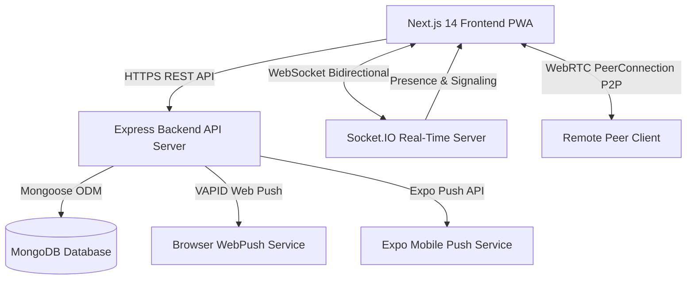
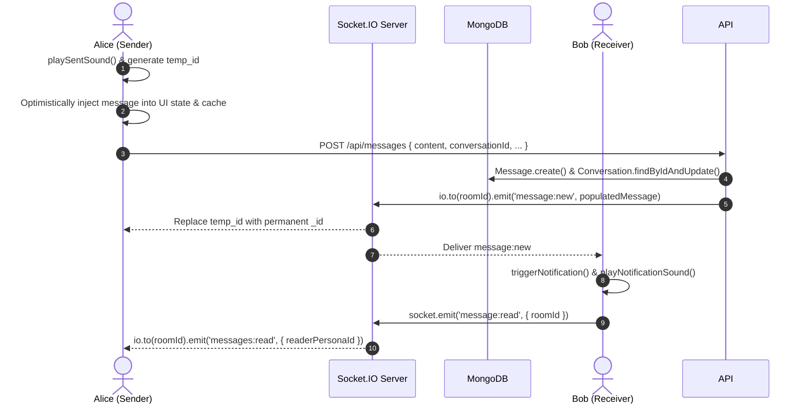
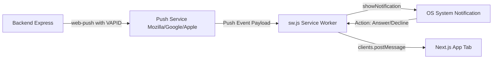

# GenAce Architecture & Implementation Master Guide: From WebRTC Calls to Real-Time Chat Engine

This document provides a comprehensive, code-level breakdown of the **GenAce (Donchat)** real-time communications platform. It details every core subsystem, data model, network flow, and frontend/backend integration—from WebRTC signaling to multi-persona identity, privacy vectors, and background push notifications.

---

## 1. Executive System Topology



GenAce is built upon a distributed client-server architecture:
- **Frontend**: Next.js 14 (App Router), React 18, Tailwind CSS, Lucide icons, HTML5 Web Audio & MediaDevices APIs.
- **Backend**: Node.js & Express with modular REST controllers and middleware.
- **Real-Time Duplex**: Socket.IO server mounted directly on the HTTP server, managing presence, typing, messaging fanout, and WebRTC signaling.
- **Persistence**: MongoDB via Mongoose with compound indexing for low-latency queries.
- **Media & Push**: Cloudinary / local multipart disk storage, Web Push (VAPID / Web-Push library), and Expo Push services.

---

## 2. Multi-Persona Identity & Authentication System

Unlike traditional chat apps where an account maps 1:1 with a profile, GenAce decouples the **Master Account** from **Active Personas**.

### 2.1 Schema Architecture

1. **User Schema (`backend/models/User.js`)**:
   - `email`: Master login email.
   - `password`: Bcrypt hashed password.
   - `masterName`: Legal or primary account name.
   - `personas`: Array of `ObjectId` references to `Persona` documents.
   - `chatPasscode`: Hashed passcode for locked/hidden conversations.
   - `chatLockEnabled`: Boolean flag toggling privacy mode.
   - `lockedConversations` & `lockedSpaces`: Array of string IDs hidden behind the passcode.

2. **Persona Schema (`backend/models/Persona.js`)**:
   - `userId`: Back-reference to the parent User document.
   - `username`: Unique handle across the entire platform (`@username`).
   - `displayName`: Formatted display name (e.g., "Agent Smith").
   - `avatar`: URL to profile image or Cloudinary asset.
   - `bio`: Persona biography or status note.
   - `type`: Enum (`personal`, `business`, `gaming`, `anonymous`).
   - `status`: Enum (`online`, `away`, `dnd`, `offline`).
   - `customStatus`: Free-form status string (e.g., "Designing Fluid Spaces...").
   - `blockedPersonas`: List of persona IDs mutually blocked.
   - `contacts`: Personal address book of connected personas.
   - `pushTokens`: Web Push & Expo push subscriptions.

### 2.2 JWT Authentication & Context Switching

When a user logs in via `POST /api/auth/login`:
```javascript
// Token generation encodes both userId and active personaId
const token = jwt.sign(
  { userId: user._id, personaId: activePersona._id },
  process.env.JWT_SECRET,
  { expiresIn: '30d' }
);
```

On persona switch (`POST /api/personas/switch`):
A new JWT is generated with the selected `personaId`. The frontend updates its global `AuthContext` and reconnects the Socket.IO client:
```javascript
socket.emit('presence:announce', { personaId: newPersona._id });
```
This guarantees instant isolation: conversations, presence status, blocked contacts, and typing indicators immediately reflect the selected persona without requiring a full re-login.

---

## 3. Real-Time Voice & Video Calling Engine

The calling engine uses **WebRTC (Web Real-Time Communication)** for peer-to-peer audio and video transmission, paired with **Socket.IO** as the stateful signaling server.

```mermaid
sequenceDiagram
    autonumber
    actor Caller as Caller Client
    participant Server as Socket.IO & Push Server
    actor Callee as Callee Client

    Caller->>Caller: getUserMedia({ audio: true, video: isVideo })
    Caller->>Server: socket.emit('call:initiate', { targetPersonaId, roomId, isVideo, callId })
    Server->>Server: Register in activeRingingCalls Map (45s timeout)
    Server-->>Callee: socket.emit('call:incoming', callData)
    Server-)Callee: sendPushNotifications (Web Push + Sound)
    Caller->>Caller: playRingback()
    Callee->>Callee: playIncomingRingtone() + navigator.vibrate()

    alt Callee Accepts
        Callee->>Callee: stopAllSFX() & getUserMedia(...)
        Callee->>Server: socket.emit('call:accept', { targetPersonaId, callId })
        Server-->>Caller: socket.emit('call:accepted', { callId, responderSocketId })
        Caller->>Caller: pc.createOffer() -> pc.setLocalDescription(offer)
        Caller->>Server: socket.emit('call:signal', { signal: offer })
        Server-->>Callee: socket.emit('call:signal', { signal: offer })
        Callee->>Callee: pc.setRemoteDescription(offer) -> pc.createAnswer()
        Callee->>Server: socket.emit('call:signal', { signal: answer })
        Server-->>Caller: socket.emit('call:signal', { signal: answer })
        Caller->>Caller: pc.setRemoteDescription(answer)
        Caller<-->>Callee: P2P Audio / Video Stream via RTCPeerConnection
    else Callee Declines / Timeout
        Callee->>Server: socket.emit('call:reject', { callId, reason })
        Server-->>Caller: socket.emit('call:rejected', { callId })
        Caller->>Caller: cleanupCall() & playCallEnded()
    end
```

### 3.1 Signaling Architecture (`backend/config/socket.js`)

1. **Active Ringing Calls Registry**:
   The server maintains an in-memory `activeRingingCalls` Map:
   ```javascript
   export const activeRingingCalls = new Map();
   // Key: callId -> { callId, callerPersona, callerSocketId, targetPersonaId, roomId, isVideo, timestamp, timeoutTimer }
   ```
   - Automatically expires after **45 seconds** if unanswered, emitting `call:ended { reason: 'timeout' }` to both parties.
   - Cleans up automatically if the caller disconnects mid-ring.

2. **Targeted Socket Routing (`callTarget`)**:
   ```javascript
   const callTarget = (targetPersonaId, targetSocketId) =>
     targetSocketId && io.sockets.sockets.get(targetSocketId)
       ? io.to(targetSocketId)
       : io.to(`persona:${targetPersonaId}`);
   ```
   If a user is logged in across 2 browser tabs or devices, answering on device A cancels ringing on device B via `call:answered-elsewhere`, preventing audio glare or double-answering conflicts.

3. **Background Fallback Query (`call:query-pending`)**:
   If a user was on a locked phone screen or reloaded their browser when a call was placed, the client queries pending calls upon reconnecting, and the server immediately re-emits `call:incoming`.

### 3.2 Peer Connection & SDP Negotiation (`frontend/src/app/chat/page.js`)

1. **ICE Servers & STUN/TURN**:
   The client loads STUN/TURN configurations dynamically from `/api/ice-servers`:
   ```javascript
   const pc = new RTCPeerConnection({
     iceServers: iceServersRef.current || [{ urls: 'stun:stun.l.google.com:19302' }],
     iceCandidatePoolSize: 4
   });
   ```

2. **Track Attachment & Transceiver Synchronization**:
   ```javascript
   localStream.getTracks().forEach(track => {
     pc.addTrack(track, localStream);
   });
   pc.getTransceivers().forEach(t => { t.direction = 'sendrecv'; });
   ```

3. **Trickle ICE Candidate Queuing**:
   Candidate objects arriving before the remote SDP description is set are placed into `pendingCandidatesRef.current` and flushed via `processPendingCandidates(pc)` once `setRemoteDescription` resolves, avoiding negotiation race conditions.

4. **Call Hardware Controls**:
   - **Mute / Unmute**: Flips `track.enabled` on local audio tracks directly without tearing down the connection.
   - **Camera Toggle**: Flips `track.enabled` on local video tracks.
   - **Screen Sharing**: Calls `navigator.mediaDevices.getDisplayMedia()` and replaces the video track on the WebRTC RTCRtpSender via `sender.replaceTrack(screenTrack)`. When screen sharing ends, it seamlessly swaps back to the camera track.

### 3.3 Audio & Ringtone Subsystem

GenAce implements a dual audio engine:
1. **Dynamic Web Audio Synthesis (`lib/callSFX.js`)**:
   Uses the Web Audio API (`AudioContext`, `OscillatorNode`, `GainNode`) to generate authentic telecom frequencies:
   - **Ringback Tone**: Dual-tone multi-frequency (440Hz + 480Hz) pulsed in 2s-on / 4s-off cadence.
   - **Call Connected Chime**: Rising melodic arpeggio (C5 $\rightarrow$ E5 $\rightarrow$ G5).
   - **Call Ended Tone**: Descending tone (440Hz $\rightarrow$ 220Hz).
2. **Device-Native / Custom Ringtone Manager (`lib/ringtoneManager.js`)**:
   - Supports uploading custom audio files (`.mp3`, `.wav`, `.ogg`), stored locally in **IndexedDB**.
   - Triggers native hardware vibration via `navigator.vibrate([1000, 500, 1000, 500, 1000])`.
   - Bypasses browser autoplay restrictions using silent audio unlock events on first user interaction.

---

## 4. Real-Time Chat Engine

### 4.1 Schema & Data Models

1. **Conversation Model (`backend/models/Conversation.js`)**:
   - `type`: `direct` (1-on-1) or `group`.
   - `participants`: Array of Persona references.
   - `privacyMode`: `normal`, `private`, `disappearing`, `burn`, `vault`, `anonymous`.
   - `spaceId`: If linked to a fluid space, references the parent `Space`.
   - `lastMessage`: Pointer to the most recent Message for instant inbox rendering.
   - `deletedBy`: Array of Persona IDs who hid the conversation locally.

2. **Message Model (`backend/models/Message.js`)**:
   - `conversationId` / `spaceId`: Target context.
   - `senderPersonaId`: Author persona reference.
   - `content`: Text payload.
   - `contentType`: `text`, `voice`, `image`, `video`, `file`, `document`, `poll`, `task_card`, `secret_lovers_invite`.
   - `mediaUrl`: URL to uploaded attachment.
   - `voiceDuration`: Duration in seconds for voice notes.
   - `privacyMode`: Conversation privacy setting snapshot.
   - `isBurned`: True if viewed in "burn-on-read" mode.
   - `reactions`: Array of `{ emoji, personaId }`.
   - `replyTo`: Parent message reference for threaded replies.
   - `status`: `sent`, `delivered`, `read`.
   - `expiresAt`: TTL timestamp for disappearing messages (auto-removed by MongoDB).

### 4.2 0ms Optimistic Messaging & Delivery Loop



1. **Optimistic UI Update**:
   When the user presses Enter or taps Send:
   - A unique temporary ID (`temp_1729...`) is created.
   - The message is immediately rendered with a subtle `pending: true` indicator.
   - An audio chime (`playSentSound()`) provides instant haptic-like feedback.
2. **Server Ingestion & Fanout**:
   - `sendMessage` controller validates room permissions and blocklists.
   - Populates sender persona metadata (`displayName`, `avatar`, `status`).
   - Simultaneously writes to MongoDB and fans out via Socket.IO:
     - `io.to(targetRoom).emit('message:new', msg)`
     - `io.to('persona:' + recipientId).emit('message:new', msg)` (for instant inbox snippet refresh across all tabs).
3. **Delivery & Read Acknowledgments**:
   - When the receiver views the chat viewport, `markActiveRoomAsRead()` triggers `socket.emit('message:read')`.
   - The server updates `status: 'read'` in MongoDB and broadcasts `messages:read`, turning the sender's checkmarks from delivered to read.

### 4.3 Privacy Vectors Breakdown

| Privacy Mode | Description | Technical Implementation |
|---|---|---|
| **Normal** | Standard persistent messaging | Regular MongoDB document with real-time sync |
| **Private** | Confidential view | Strips message snippets from notifications and mobile lock screens |
| **Disappearing** | Ephemeral messaging | Sets `expiresAt = Date.now() + 24h`; MongoDB TTL index automatically purges expired records |
| **Burn-on-Read** | View once and destroy | Payload rendered masked; client calls `POST /api/messages/:id/burn` on click, destroying content on the server immediately |
| **Vault** | High-security space | Content gated behind the user's master chat passcode |
| **Anonymous** | Ghost identity | Masks sender handle and details with randomized ghost identity in the space |

---

## 5. Media Upload Pipeline & Voice Notes

### 5.1 Multi-Tier File Upload Pipeline (`backend/routes/upload.routes.js`)
File uploads pass through an intelligent fallback pipeline:
1. **Cloudinary CDN**: If configured in `.env`, streams images/videos/audio to Cloudinary CDN for global caching and resizing.
2. **Local Disk Storage**: If Cloudinary is absent or errors, saves files to `backend/uploads/` with unique sanitized filenames.
3. **Base64 Direct Serialization**: Fallback mode for high-availability environments where file storage writes are restricted.

### 5.2 Voice Notes Engine (`frontend/src/components/MessageInput.jsx`)
- Uses the browser's `MediaRecorder` API with mimeType `audio/webm;codecs=opus` (or `audio/mp4` on iOS Safari).
- Visualizes real-time decibel input levels using HTML5 `AudioContext` and `AnalyserNode`.
- Uploads the recorded audio blob directly to `/api/upload`, extracts duration, and dispatches a message with `contentType: 'voice'` and `voiceDuration`.

---

## 6. Fluid Spaces, Collaboration & Games

### 6.1 Fluid Spaces Architecture (`backend/models/Space.js`)
Spaces represent dynamic group environments combining chat, shared tasks, live polls, and games:
- **Roles**: `owner`, `admin`, `member`.
- **Visibility**: `public` (discoverable in Explore) or `private` (invite only).
- **Embedded Conversation**: Each space has a dedicated `conversationId` for unified chat storage.

### 6.2 Secret Lovers Game Engine (`backend/models/SecretLoversGame.js`)
An interactive social card game integrated directly into spaces:
- Turn-based matchmaking and secret card selections.
- Emits dedicated interactive chat cards (`secret_lovers_invite`, `secret_lovers_summary`).
- Real-time turn progression managed via Socket.IO events (`secretLovers:stateUpdate`).

---

## 7. AI Assistant & Space Summarization Engine

The backend provides context-aware AI operations (`backend/services/ai.service.js`):

```javascript
export const processAIQuery = async ({ action, conversationId, spaceId, queryText }) => {
  // Scoped strictly to the active space's recent 30 messages
  const messages = await Message.find(filter).sort({ createdAt: -1 }).limit(30);
  ...
}
```

- **`SUMMARIZE` / `CATCH_UP`**: Aggregates conversation participants, extracts conversational focus, and produces a bulleted briefing.
- **`EXTRACT_DECISIONS`**: Scans messages for decision keywords (`agree`, `decided`, `approved`, `let's`) and tabulates conclusions with authors and timestamps.
- **`EXTRACT_TASKS`**: Identifies action items (`todo`, `need to`, `build`, `fix`) and proposes assignees.
- **`CUSTOM_QUERY`**: Natural-language semantic search across the conversation history.

---

## 8. Web Push Notifications & Service Worker



1. **VAPID Key Auto-Generation (`backend/config/push.js`)**:
   - Generates and persists VAPID keypairs in `config/vapid.json` if environment variables are not supplied.
2. **Background Calls & Action Buttons (`public/sw.js`)**:
   - When a call arrives while the browser is minimized or closed:
     - The service worker displays a persistent notification with `requireInteraction: true` and action buttons: `📞 Answer` and `✕ Decline`.
     - Clicking **Decline** directly invokes `POST /api/calls/reject` from inside the service worker thread, alerting the caller without requiring the full app to load.
     - Clicking **Answer** calls `clients.openWindow('/chat')` and brings the call modal into focus.

---

## 9. Progressive Web App (PWA) Subsystem

The PWA enables zero-friction, native-like installation directly from any shared link.

1. **Manifest Configuration (`public/manifest.json`)**:
   - Configured with `display: "standalone"`, `start_url: "/"`, `display_override: ["standalone", "minimal-ui", "window-controls-overlay"]`.
   - Incorporates dedicated 192x192 and 512x512 standard PNG and maskable PNG icons.
2. **Service Worker Caching (`public/sw.js`)**:
   - Implements a network-first fetch handler for static assets and HTML shell fallback, fulfilling Chromium's PWA installability requirements while exempting `/api` and `/socket.io`.
3. **Install Lifecycle Manager (`frontend/src/context/PWAContext.jsx`)**:
   - Detects standalone mode via `matchMedia('(display-mode: standalone)')`.
   - Captures and holds the browser's `beforeinstallprompt` event.
   - Provides unified state (`canInstall`, `isInstalled`, `isIOS`, `promptInstall`) to the application.
4. **Interactive Modal (`frontend/src/components/InstallPromptModal.jsx`)**:
   - Displays a glassmorphic prompt with glowing app icon and feature highlights.
   - On Android/Desktop: triggers `deferredPrompt.prompt()`.
   - On iOS Safari: renders a step-by-step visual guide pointing to Safari's Share button (⎋) $\rightarrow$ *"Add to Home Screen"* (➕).
---

## 10. Privacy Onboarding, Demo Showcase & Fluid Space Lifecycle

### 10.1 Privacy Onboarding & Discovery Gate (`frontend/src/components/PrivacySetupModal.jsx`)
To ensure total user consent before public indexing:
1. **Persona Privacy Schema (`backend/models/Persona.js`)**:
   - `privacySettings.setupCompleted`: Boolean flag tracking whether user finished onboarding.
   - `privacySettings.whoCanFindMe`: `'everyone'` | `'contacts'` | `'nobody'`.
   - `privacySettings.onlineVisibility`: `'everyone'` | `'contacts'` | `'nobody'`.
   - `privacySettings.newAccountAnnouncements`: Boolean opt-in for broadcasting presence upon join.
   - `privacySettings.agreedAt`: ISO timestamp of user agreement.
2. **Server-Side Discovery Gating (`backend/controllers/persona.controller.js`)**:
   - Both `getAllContacts` and `searchPersonas` filter out users whose `setupCompleted` is `false` or whose discovery mode restricts visibility, preventing non-consensual indexing on the "Friends" directory.
3. **Presence Masking & Stealth Mode (`backend/config/socket.js`)**:
   - Socket connection inspects persona `onlineVisibility`. Personas selecting `'nobody'` are broadcast as `offline` in global presence registries.
4. **Responsive Modal UI**:
   - Implemented across Web (`PrivacySetupModal.jsx`) and Mobile React Native (`PrivacySetupModal.js`) with responsive `max-h-[92vh]`, internal scrollable body, and pinned "Continue to GenAce" action button.

### 10.2 Demo Account Showcase Architecture (`backend/controllers/auth.controller.js`)
A restricted tour mode allowing prospective users to test live messaging, WebRTC calls, and fluid spaces:
1. **User Flag**: `user.isDemo: true` persisted on the master account.
2. **Zero-Friction Tour Onboarding**:
   - `demoLogin` initializes `demo@donchat.com`, clears any previous passcodes, auto-completes privacy setup for immediate test discovery, and provisions a companion persona (`@genace_guide` - *GenAce Showcase Companion*).
   - Generates a starter direct message introducing interactive features (voice notes, real-time audio/video calls, fluid spaces).
3. **Security Lockdown Enforcements**:
   - Changing password (`POST /api/auth/change-password`): Rejected with HTTP 403.
   - Modifying passcode lock (`POST /api/auth/set-chat-passcode`): Rejected with HTTP 403.
   - Deleting fluid spaces (`DELETE /api/spaces/:id`): Rejected with HTTP 403.
   - Persistent showcase banner rendered in frontend and mobile informing users of demo testing mode with direct link to register their own free account.

### 10.3 Fluid Space Exit Lifecycle & Sidebar Restoration
1. **Clean State Reset (`frontend/src/app/chat/page.js`)**:
   - `handleCloseActiveChat()` executes a comprehensive teardown: leaves active socket room (`leaveRoom`), clears `activeId`, `activeType`, and `activeObject`, flushes messages/tasks/polls, and removes cached active ID keys from `localStorage`.
2. **Dynamic Sidebar Mode Switching (`frontend/src/components/RightMembersPanel.jsx`)**:
   - Space members mode is conditionally guarded: `activeSpace={(activeId && activeType === 'space') ? activeObject : null}`.
   - When a space is closed, deleted, or left, the panel automatically falls back to the default **Online Contacts & Members Directory** form.
3. **Member Self-Removal ("🚪 Leave Space") (`backend/controllers/space.controller.js`)**:
   - Allows non-owner space participants to voluntarily leave spaces via `DELETE /api/spaces/:spaceId/members/:personaId` without requiring admin permissions (`isSelf`).
   - Dispatches real-time `space:left` and `space:member_removed` Socket.IO events to synchronise participant rosters.

---

## 11. Platform Feature Parity & Gap Analysis: Web vs. Mobile

This section provides a granular comparison between the **Web Platform (Next.js 14 PWA)** and the **Mobile Application (React Native / Expo)**, detailing every feature exclusive to the web and the technical gap on mobile.

### 11.1 Executive Feature Matrix

| Feature / Architectural Vector | Web Platform (`frontend`) | Mobile App (`mobile`) | Parity Status & Technical Reason |
| :--- | :---: | :---: | :--- |
| **P2P WebRTC Video & Audio Calls** | **Full Native WebRTC** (`RTCPeerConnection`, `<video>`, `<audio>`) | **Web Fallback Only** (`Platform.OS === 'web'`) | ⚠️ **Web Exclusive**: Native iOS/Android builds require bare prebuild with `react-native-webrtc` drivers. |
| **Secret Lovers Interactive Card Game** | **Full Engine + Procedural SFX** (`secretLoversSFX.js`, interactive cards) | **Not Implemented** | ❌ **Web Exclusive**: Card flip animations, matchmaking cards, and game SFX have not been ported to React Native. |
| **Progressive Web App (PWA) Engine** | **Full PWA** (`InstallPromptModal`, `sw.js`, VAPID WebPush) | **N/A (Native App)** | ℹ️ **Web Specific**: Mobile uses native OS packaging (Expo/EAS, APNs, FCM). |
| **Background Call Action Buttons** | **Service Worker Notifications** (`📞 Answer` / `✕ Decline`) | **Standard Push Notifications** | ❌ **Web Exclusive**: Service worker handles decline REST API calls in background without app launch. |
| **Persistent 3-Column Workspace** | **Full 3-Column Layout** (Nav + Workspace + Right Members Panel) | **Single-Column Stack** | ℹ️ **Form-Factor**: Mobile uses tab navigation and bottom sliding drawers. |
| **Dual-Mode Members Panel (`RightMembersPanel`)** | **Dedicated Panel** (Space roster, admin tools, kick/leave + Contacts) | **Basic Contacts Drawer** (`MembersDrawerModal`) | ⚠️ **Web Exclusive**: Mobile drawer only lists general contacts; lacks space members roster, admin tools, and self-leave. |
| **Space Administration & Emoji Customizer** | **Full Controls** (Preset emoji icons, rename, kick member, delete) | **Modal-Only Editing** | ⚠️ **Web Superior**: Web has inline space header editing with 16 preset cosmic emojis and member removal. |
| **Member Voluntary Self-Leave ("🚪 Leave Space")** | **Interactive Button + Socket Flow** (`onLeaveSpace`) | **Not Implemented in UI** | ❌ **Web Exclusive**: Web allows members to leave spaces directly from the members sidebar. |
| **Dedicated Full-Page Admin Dashboard** | **Full Admin Suite** (`AdminView.jsx`, space audit, user ban) | **Compact Popup** (`AdminModal.js`) | ⚠️ **Web Exclusive**: Web has a full analytics dashboard with live inspection of spaces and users. |
| **Procedural Web Audio API Synthesizer** | **Mathematical Sound Synthesizer** (`callSFX.js`, dual-sine waves) | **Expo-AV Static Files** | ❌ **Web Exclusive**: `window.AudioContext` is browser-only; native mobile uses static audio assets. |
| **Custom Ringtone Manager (IndexedDB)** | **User Audio Uploads + IndexedDB** (`ringtoneManager.js`) | **Bundled Ringtones Only** | ❌ **Web Exclusive**: Web lets users upload MP3/WAV files stored in client IndexedDB. |
| **Live Voice Note Decibel Waveform Analyser** | **Real-Time Visualizer** (`AnalyserNode` frequency bars) | **Duration Timer Only** | ❌ **Web Exclusive**: Web dynamically draws soundwave decibel bars while recording voice notes. |
| **Zero-Latency In-Memory Message Cache** | **LRU Memory Cache** (`messageCache.js`, 0ms space/chat switch) | **REST Refetch on Mount** | ⚠️ **Web Superior**: Web loads instantly from memory before server revalidation. |
| **Live In-App Webcam Photo Capture** | **Webcam Viewfinder Modal** (`navigator.mediaDevices.getUserMedia`) | **System Camera App** (`expo-image-picker`) | ℹ️ **Platform Native**: Mobile delegates to the native device camera app. |
| **Global Hardware Keyboard Shortcuts** | **`Ctrl + K` search, `Esc` deselect, `Enter` send** | **Touch Gestures Only** | ℹ️ **Form-Factor**: Desktop keyboard optimized. |
| **Desktop Welcome Canvas & Launchpad** | **Interactive Welcome Canvas** (`WelcomeScreen.jsx`, 2x2 cards) | **Direct Tab View** | ℹ️ **Form-Factor**: Desktop displays hero cards when no conversation is active. |

---

### 11.2 Deep-Dive: Features Available on Web but Missing or Limited on Mobile

#### 1. Interactive Secret Lovers Social Game Engine
- **Web**: Includes an interactive card game built directly into fluid spaces and direct messages. Features real-time turn progression, card flip animations, countdown chimes, and dedicated sound effects synthesized procedurally via `frontend/src/lib/secretLoversSFX.js`.
- **Mobile Gap**: The mobile client has no Secret Lovers game renderer, game invite cards, or game SFX.

#### 2. Native WebRTC P2P Audio & Video Streaming
- **Web**: Implements full `RTCPeerConnection` with bidirectional audio and video tracks, local/remote video rendering in `<video>` tags, device selection (mic/cam), and Web Audio synthesis for ringtones.
- **Mobile Gap**: `mobile/src/components/CallModal.js` is currently restricted to web runtime (`Platform.OS === 'web'`). Native iOS/Android builds require bare workflow migration with `react-native-webrtc` native drivers.

#### 3. Dual-Mode Members Directory & Fluid Space Management
- **Web**: Features `RightMembersPanel.jsx` which dynamically toggles between:
  - **Space Members Mode**: Displays space member count, owner/admin badges, 16 preset space icon selectors, admin delete space button, member kick actions, and member voluntary self-leave ("🚪 Leave Space").
  - **General Contacts Mode**: Displays real-time online contacts with live presence dots, search filtering, and offline contact lists.
- **Mobile Gap**: `MembersDrawerModal.js` on mobile only displays a general contacts list. It does not display active space members, member roles, kick buttons, or voluntary leave options.

#### 4. Service Worker Background Calls & PWA Install Engine
- **Web**: Integrates `public/sw.js` and `InstallPromptModal.jsx`. Incoming calls while the browser is closed or minimized trigger persistent system notifications with interactive `📞 Answer` and `✕ Decline` action buttons that invoke backend endpoints without loading the app shell.
- **Mobile Gap**: Mobile relies on Expo Push Notifications, which currently display standard notification banners without background call action button hooks.

#### 5. Custom Ringtone Upload & Client IndexedDB Persistence
- **Web**: `SettingsView.jsx` provides a full ringtone studio (`ringtoneManager.js`) where users can upload custom MP3, WAV, or OGG audio files, test-play them in the browser, and store them client-side in browser IndexedDB.
- **Mobile Gap**: Mobile settings only allow switching between static presets via `expo-av`, with no user upload or persistent client storage for custom audio files.

#### 6. Live Audio Waveform Decibel Analyzer
- **Web**: `MessageInput.jsx` hooks into the browser `AudioContext` and `AnalyserNode` during voice note recording, dynamically rendering live bouncing audio frequency bars that reflect microphone volume.
- **Mobile Gap**: Mobile records via `expo-av` displaying only an elapsed duration text counter (`0:05`).

#### 7. Full-Page Platform Admin Dashboard
- **Web**: `AdminView.jsx` provides a dedicated management dashboard for administrators, enabling live inspection of active spaces, platform-wide analytics, and one-click space termination.
- **Mobile Gap**: Mobile provides only a compact `AdminModal.js` dialog with limited functionality.

#### 8. In-Memory Zero-Latency Cache Engine
- **Web**: `messageCache.js` caches the last 100 messages for each space and conversation in client memory, enabling instant (0ms) room switching before background revalidation.
- **Mobile Gap**: Mobile re-fetches message history over the network each time a conversation is opened.

---

### 11.3 Roadmap for Mobile Feature Parity

To bring the mobile application to 100% feature parity with the web platform, the following engineering steps are recommended:

1. **Bare Workflow Prebuild for WebRTC**: Run `npx expo prebuild` and integrate `react-native-webrtc` with native video views (`RTCView`) for iOS and Android.
2. **Secret Lovers Mobile Port**: Create React Native interactive card components (`SecretLoversCard.js`) and replicate card flip animations using `react-native-reanimated`.
3. **Space Members in Mobile Drawer**: Upgrade `MembersDrawerModal.js` to accept `activeSpace`, displaying space members, admin tools, and the "Leave Space" action.
4. **Interactive Push Notification Actions**: Configure `expo-notifications` with notification categories and background task handlers for incoming call Answer/Decline actions.
5. **MMKV / SQLite Caching Layer**: Implement an offline in-memory cache using `react-native-mmkv` to achieve 0ms room switching on mobile.

---

## 12. File & Directory Reference

```text
DONCHAT/
├── backend/
│   ├── config/
│   │   ├── db.js                 # MongoDB connection initialization
│   │   ├── push.js               # Web Push (VAPID) & Expo Push service
│   │   └── socket.js             # Real-time Socket.IO server & WebRTC signaling
│   ├── controllers/
│   │   ├── auth.controller.js    # Registration, login, password reset, demo tour
│   │   ├── message.controller.js # Message creation, read receipts, reactions, burn
│   │   ├── persona.controller.js # Multi-persona creation, privacy gate, switching
│   │   └── space.controller.js   # Spaces, members, tasks, self-leave, and polls
│   ├── models/
│   │   ├── Conversation.js       # 1-on-1 and group conversation schema
│   │   ├── Message.js            # Unified message schema with privacy vectors
│   │   ├── Persona.js            # Identity persona & privacySettings schema
│   │   ├── PushSubscription.js   # Browser push subscription storage
│   │   ├── Space.js              # Fluid spaces schema
│   │   └── User.js               # Master user account schema & isDemo flag
│   └── server.js                 # Express HTTP server setup & middleware
├── frontend/
│   ├── public/
│   │   ├── manifest.json         # PWA metadata & application manifest
│   │   ├── sw.js                 # Service worker for push & offline shell
│   │   ├── icon-192.png          # High-res PWA icon (192x192)
│   │   └── icon-512.png          # High-res PWA icon (512x512)
│   └── src/
│       ├── app/
│       │   ├── chat/page.js      # Core messaging, spaces controller & WebRTC engine
│       │   ├── layout.js         # Root layout with PWA, Socket, and Auth providers
│       │   └── welcome/page.jsx  # Welcome landing page with install triggers
│       ├── components/
│       │   ├── AdminView.jsx          # Dedicated platform admin dashboard
│       │   ├── CallModal.jsx          # Active WebRTC audio/video call UI
│       │   ├── IncomingCallModal.jsx  # Ringing incoming call modal with silence controls
│       │   ├── InstallPromptModal.jsx # Cosmic PWA install modal & floating pill
│       │   ├── MessageInput.jsx       # Voice note recorder, waveform analyzer, text input
│       │   ├── MessageItem.jsx        # Rich message bubble, reactions, burn animations
│       │   ├── PrivacySetupModal.jsx  # Privacy onboarding consent dialog
│       │   ├── RightMembersPanel.jsx  # Dual-mode members directory & space admin panel
│       │   ├── SettingsView.jsx       # Custom ringtones, passcode lock, privacy controls
│       │   ├── Sidebar.jsx            # Conversations, spaces list, persona switcher
│       │   ├── SpaceCanvas.jsx        # Inline space tasks & polls workspace
│       │   └── WelcomeScreen.jsx      # Desktop welcome canvas & quick launchpad
│       ├── context/
│       │   ├── AuthContext.jsx   # Master user & active persona state
│       │   ├── PWAContext.jsx    # PWA install prompt & standalone detection
│       │   └── SocketContext.jsx # Socket.IO client singleton connection
│       └── lib/
│           ├── api.js                # Axios HTTP client with JWT interceptors
│           ├── callSFX.js            # Web Audio API procedural sound synthesizer
│           ├── messageCache.js       # Zero-latency in-memory message cache
│           ├── pushSubscription.js   # Client WebPush registration helper
│           ├── ringtoneManager.js    # Custom ringtone IndexedDB storage & vibration
│           ├── secretLoversSFX.js    # Secret Lovers procedural game sound synthesizer
│           └── sound.js              # Notification & sent message chime player
└── mobile/
    └── src/
        ├── components/
        │   ├── MembersDrawerModal.js # General contacts sliding drawer
        │   ├── PrivacySetupModal.js  # React Native privacy onboarding consent dialog
        │   ├── SpaceCanvasModal.js   # Space tasks & polls modal popup
        │   └── CallModal.js          # Web-runtime WebRTC call modal
        └── screens/
            ├── ConversationScreen.js # Mobile messaging room view
            └── MainTabScreen.js      # Mobile core tab navigator & demo showcase banner
```
